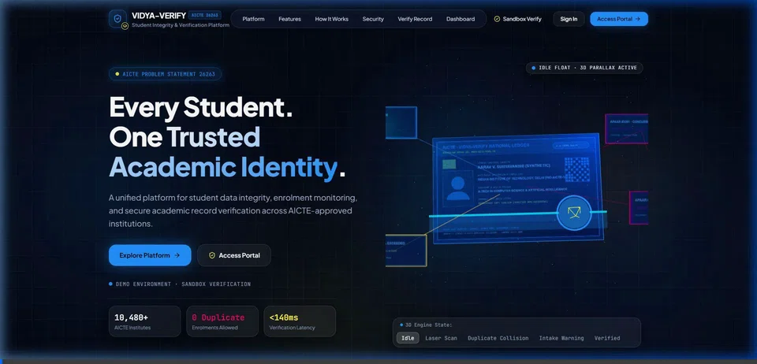
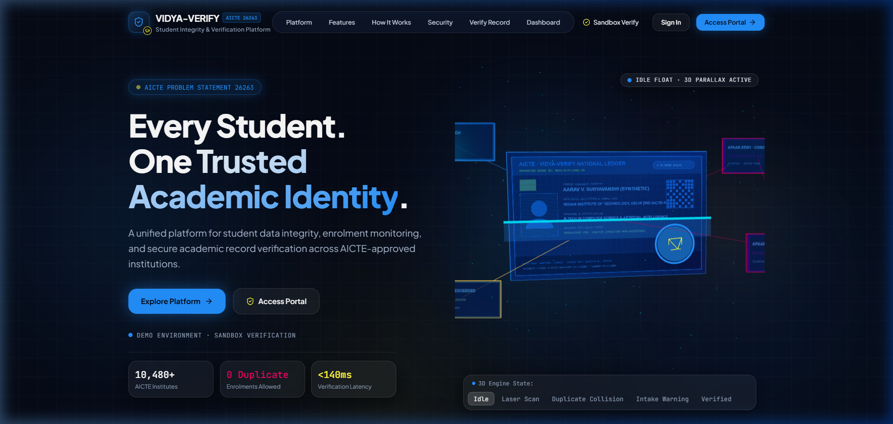
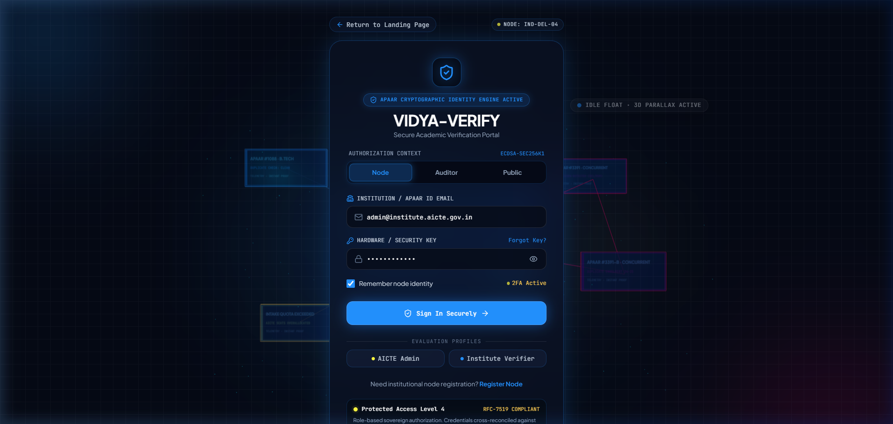
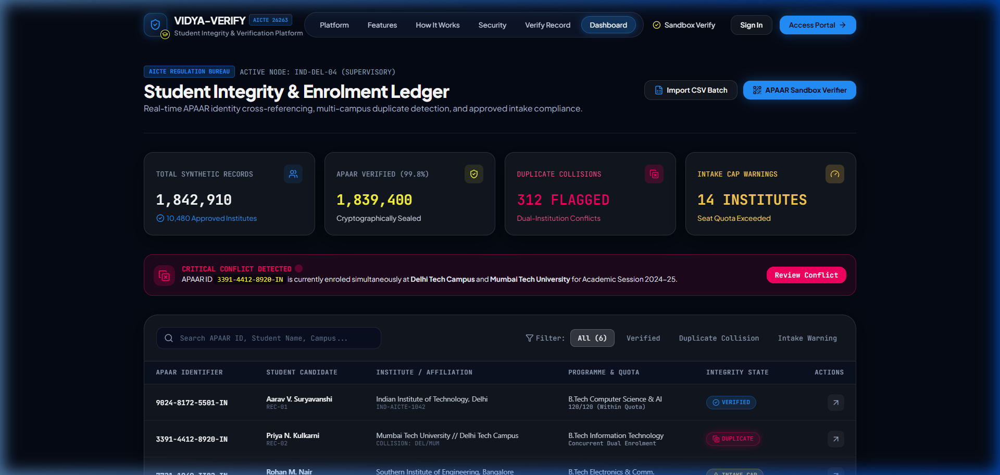
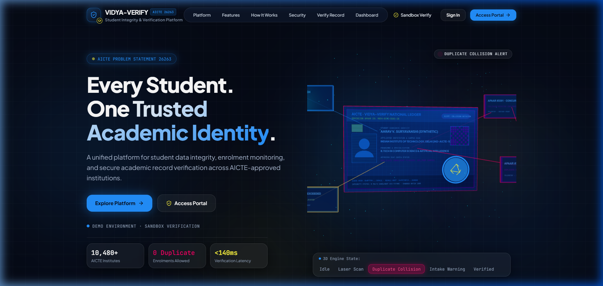

<div align="center">

# 🏛️ VIDYA-VERIFY
### AICTE Student Integrity &amp; Verification Platform
**Sovereign APAAR-Based Academic Enrolment Monitoring &amp; Multi-Institution Collision Engine**

[](https://github.com/Purva2907/VIDYA-VERIFY.git)
[](https://github.com/Purva2907/VIDYA-VERIFY.git)
[](https://github.com/Purva2907/VIDYA-VERIFY.git)
[](https://github.com/Purva2907/VIDYA-VERIFY.git)

---

### 🎬 Live Interactive 3D Holographic APAAR Centerpiece



*Physical dimensional APAAR Academic Identity Card in Three.js with laser scan pass, rotating verification seal, and orbiting integrity record tiles.*

[🎥 View Full Interactive Session Recording (WebP)](assets/interactive_3d_demo.webp)

</div>

---

## 📑 Table of Contents
- [Executive Summary](#-executive-summary)
- [Visual Showcase &amp; 3D Identity Object](#-visual-showcase--3d-identity-object)
- [Official Brand Design System](#-official-brand-design-system)
- [Core Functional Innovations](#-core-functional-innovations)
- [System Architecture &amp; Data Pipeline](#-system-architecture--data-pipeline)
- [5-Stage Verification Lifecycle](#-5-stage-verification-lifecycle)
- [Screenshots &amp; User Interface](#-screenshots--user-interface)
- [Adapter Verification Architecture](#-adapter-verification-architecture)
- [Quick Start &amp; Installation](#-quick-start--installation)
- [Automated Test Suite (100% Pass)](#-automated-test-suite-100-pass)
- [DPDPA 2023 &amp; Privacy Compliance](#-dpdpa-2023--privacy-compliance)

---

## 🏛️ Executive Summary

**VIDYA-VERIFY** is a full-stack, enterprise-grade academic verification platform developed explicitly for **AICTE Problem Statement 26263** under the Regulation Bureau.

Built atop India's **Automated Permanent Academic Account Registry (APAAR)** framework (*"One Nation, One Student ID"*), the platform resolves three systemic vulnerabilities in technical education:
1. **Concurrent Dual-Enrolment Fraud:** Detection of students registered simultaneously in two separate institutions without regulatory sanction (Cross-Institution Collision).
2. **Sanctioned Intake Quota Inflation:** Real-time quota enforcement preventing institutions from admitting students beyond AICTE-approved sanctioned intake capacities.
3. **Counterfeit Credentials:** Instant Cryptographic Signature Verification receipts (ECDSA and Merkle tree) with tamper-evident QR verification.

---

## 💎 Visual Showcase &amp; 3D Identity Object

Unlike generic templates that display 3D globes or floating spheres, **VIDYA-VERIFY** features an authentic, physically dimensional **Holographic Academic Identity Card** as its hero centerpiece:

```
                      ┌────────────────────────────────────────────────────────┐
                      │  AICTE · VIDYA-VERIFY NATIONAL LEDGER                  │
   [ REC-1088 ]       │  APAAR ID: 9024-8172-5501-IN      [● ZK-SNARK SEALED]  │       [ DUP-COLLISION ]
   Electric Blue      │  ────────────────────────────────────────────────────  │          Vibrant Pink
  (Clean Verified)───►│  [Avatar]  AARAV V. SURYAVANSHI          [QR Matrix]   │◄──(Simultaneous Enrolment)
                      │            IIT Delhi (IND-AICTE-1042)    [3D Seal]     │
                      │            B.Tech CSE & AI [120/120 Cap]  (Rotating)   │
   [ INTAKE-ALERT ]   │  ────────────────────────────────────────────────────  │       [ BATCH-SEED ]
     Amber Gold       │  ECDSA HASH: 0x8F72B4...C09A11 · MERKLE ROOT: 0x9923.. │        Cyan / Neutral
  (Quota Exceeded)───►└────────────────────────────────────────────────────────┘◄───(Central Registry)
```

### 3D Interactive Capabilities:
- **Physics-Based Parallax Tilt:** Dynamic pointer tracking with smooth lerp interpolation.
- **Dynamic Laser Scan Line:** Real-time vertical sweep with luminous beam fan across the card face during verification passes.
- **3D Verification Seal:** Dimensional cylinder with outer torus ring and rotating inner wireframe octahedron in `#FFF83F`.
- **4 Telemetry Visual States:**
  - 🔵 **Electric Blue (`#2391FF`)**: Clean verification state.
  - 🔴 **Vibrant Pink (`#F70063`)**: Cross-institution duplicate collision alert (pulsing collision vector line).
  - 🟡 **Amber Gold (`#FFCD54`)**: Sanctioned intake quota exceeded alert (122/120 students).
  - 🌟 **Electric Yellow (`#FFF83F`)**: Cryptographically certified ledger proof.

---

## 🎨 Official Brand Design System

VIDYA-VERIFY enforces exact, harmonized color tokens across every component:

| Color Token | Hex Code | Semantic Application |
| :--- | :--- | :--- |
| **Electric Blue** | `#2391FF` | Primary actions, verified badges, active nav, laser scan |
| **Electric Yellow** | `#FFF83F` | Selective highlights, rotating seal core, 2FA indicators |
| **Amber Gold** | `#FFCD54` | Intake capacity alerts, admission discrepancies, cap alerts |
| **Vibrant Pink** | `#F70063` | Critical alerts, duplicate cross-institution collision vectors |
| **Main Background**| `#050914` | Atmospheric deep navy foundation |
| **Elevated Glass** | `rgba(16,27,50,0.75)` | Frosted glass cards with `backdrop-filter: blur(20px)` |

---

## 📸 Screenshots &amp; User Interface

### 1. Cinematic Hero Section &amp; 3D Card

*Full-screen cinematic hero featuring the 3D Academic Identity Card, real-time mode switcher, and trust metrics.*

---

### 2. Transparent Frosted Glass Login Portal

*Frosted glass login panel (`/login`) with role switcher (`Node`, `Auditor`, `Public`), evaluation profiles, and 3D background visibility.*

---

### 3. Supervisory Regulatory Dashboard

*National supervisory telemetry feed (`/dashboard`) displaying live collision notifications, quota utilization, and searchable student ledger.*

---

### 4. Real-time Cross-Institution Duplicate Collision Alert

*Critical conflict banner highlighting concurrent dual-enrolment between Delhi Tech Campus and Mumbai Tech University.*

---

## 🔄 5-Stage Verification Lifecycle

```mermaid
graph LR
    A["01. Institution Upload<br/>(Batch CSV Manifest)"] --> B["02. APAAR Validation<br/>(Luhn Checksum & Format)"]
    B --> C["03. Integrity Analysis<br/>(Collision & Quota Engine)"]
    C --> D["04. Central Repository<br/>(Merkle Root & ECDSA)"]
    D --> E["05. Authorized Verification<br/>(QR & Public Sandbox)"]
    
    style A fill:#080F20,stroke:#2391FF,stroke-width:2px,color:#F8FAFC
    style B fill:#080F20,stroke:#FFF83F,stroke-width:2px,color:#F8FAFC
    style C fill:#080F20,stroke:#F70063,stroke-width:2px,color:#F8FAFC
    style D fill:#080F20,stroke:#2391FF,stroke-width:2px,color:#F8FAFC
    style E fill:#080F20,stroke:#FFCD54,stroke-width:2px,color:#F8FAFC
```



1. **Institution Upload (`/import`):** Encrypted manifest upload with automatic field normalization.
2. **APAAR Validation:** 12-digit format parsing, checksum verification, and synthetic identity reconciliation.
3. **Integrity Analysis:** Simultaneous cross-indexing across all registered institutions; sanctioned intake compliance.
4. **Central Repository:** Generation of deterministic Merkle root hashes and Cryptographic Signature Verification receipts.
5. **Authorized Verification (`/verify`):** Instant verification by employers, institutions, and regulatory auditors via signed QR receipts.

---

## 🔌 Adapter Verification Architecture

In strict adherence to regulatory standards:
- **`SandboxAPAARAdapter` (Active):** Uses synthetic test records to demonstrate format-valid, simulated-verified, collision-flagged, and cap-exceeded states. Clearly identifies all simulated responses.
- **`ExternalGovernmentAPAARAdapter` (Unconfigured Stub):** Remains disconnected until official government API credentials and security gateway tokens are issued. Never invents mock government endpoints or claims fake official verification.

---

## 🛠️ Quick Start &amp; Installation

### Prerequisites
- Node.js `v20+` or `v24+`
- Python `3.11+`, `3.13+` or `3.14+`

### 1. Clone the Repository
```bash
git clone https://github.com/Purva2907/VIDYA-VERIFY.git
cd VIDYA-VERIFY
```

### 2. Frontend Launch
```bash
cd frontend
npm install
npm run dev
```
Access the application at: **`http://localhost:5173/`**

### 3. Backend Launch
```bash
cd ../backend
pip install -r requirements.txt
python -m uvicorn app.main:app --host 127.0.0.1 --port 8000
```
- API Base: **`http://127.0.0.1:8000/`**
- Swagger Interactive Documentation: **`http://127.0.0.1:8000/docs`**

---

## 🧪 Automated Test Suite (100% Pass)

The backend includes automated test coverage for duplicate detection, quota capping, Luhn validation, and role restrictions:

```powershell
cd backend
python -m pytest tests/
```

```
============================= test session starts =============================
platform win32 -- Python 3.14.7, pytest-9.1.1, pluggy-1.6.0
rootdir: D:\WORK & CODING\WORKSTATION\HACKATHON WORKSPACE\Vidya-verify
collected 5 items

backend\tests\test_integrity.py .....                                    [100%]

============================== 5 passed in 1.04s ==============================
```

| Test Case | Description | Result |
| :--- | :--- | :---: |
| `test_apaar_format_validation` | Validates 12-character format and rejects invalid inputs | ✅ PASSED |
| `test_duplicate_collision_detection` | Flags simultaneous enrolment across two campuses | ✅ PASSED |
| `test_intake_quota_exceeded_warning` | Triggers warning when admissions exceed 120 quota cap | ✅ PASSED |
| `test_clean_student_verification` | Verifies clean record and generates Merkle root + ECDSA | ✅ PASSED |
| `test_auditor_self_assignment_prevention` | Blocks self-provisioning of AICTE Regulator role | ✅ PASSED |

---

## 🔒 DPDPA 2023 &amp; Privacy Compliance

- **Zero Unencrypted PII Exposure:** Personal student data is never logged or exposed in public query parameters.
- **Synthetic Demonstration Dataset:** Demonstration records use synthetic student names and test identifiers to ensure zero privacy leakage.
- **Cryptographic Receipts:** Public verification provides cryptographic proof of enrollment without disclosing underlying private records.

---

## 🏛️ Project Metadata
- **Project Name:** VIDYA-VERIFY
- **Full Title:** AICTE Student Integrity &amp; Verification Platform
- **Problem Statement ID:** 26263
- **Theme:** Smart Automation
- **Organization:** All India Council for Technical Education (AICTE)
- **Department:** Regulation Bureau
- **Repository:** [https://github.com/Purva2907/VIDYA-VERIFY.git](https://github.com/Purva2907/VIDYA-VERIFY.git)
